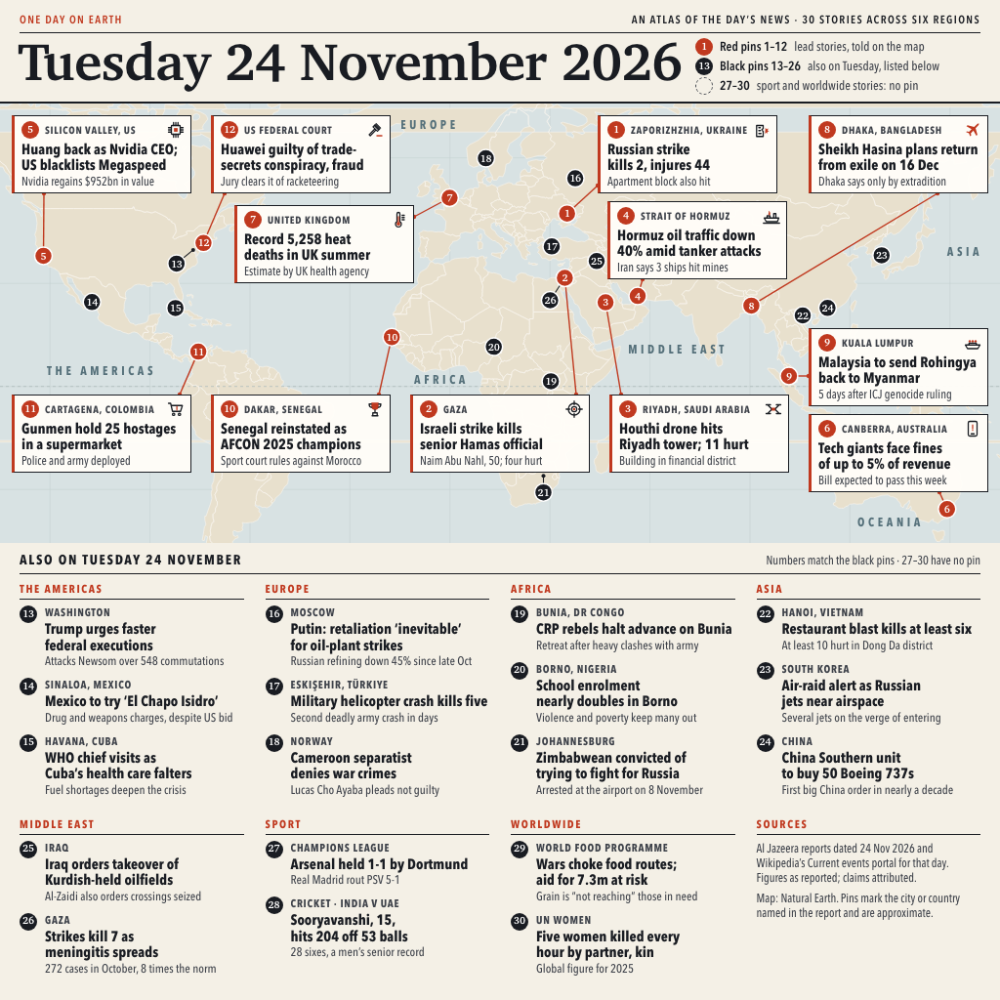

# news-1124-one-day-on-earth

[](https://make.fun/bounty/news-image-20261124?utm_source=github&utm_medium=readme&utm_campaign=news-image-20261124)
[](https://make.fun/bounty/news-image-20261124/leaderboard?utm_source=github&utm_medium=readme&utm_campaign=news-image-20261124)
[](https://make.fun/bounty/news-image-20261124?utm_source=github&utm_medium=readme&utm_campaign=news-image-20261124)

One Day on Earth is an atlas of the news of Tuesday 24 November 2026: a single world map in which twelve lead stories sit in callouts beside numbered red pins, and 18 more run below by region, numbered to black pins (sport and worldwide stories have none). All 30 stories, across six regions, come from Al Jazeera's reports of that day and Wikipedia's Current events portal (see [design/sources.md](design/sources.md)).



## Run it

```sh
mkdir -p out && MAKEFUN_OUTPUT_DIR=out node main.ts
```

`main.ts` (Node 22, standard library only, no network) checks `entry.png` against the gate (PNG signature, whole file through IEND, at most 1024×1024 and 1 MiB) and copies it to `${MAKEFUN_OUTPUT_DIR:-/output}/entry.png`. To rebuild the image, run `design/render.sh` (Node plus headless Chrome): it writes `design/atlas.html` from `design/build.mjs` and screenshots it at 1024×1024; `design/check.sh` reports any collisions between cards, pins, labels and leader lines, and any text that overflows. Map outlines come from Natural Earth via [world-atlas](https://github.com/topojson/world-atlas) (ISC).

---

<sub>Entered on [make.fun](https://make.fun/?utm_source=github&utm_medium=readme&utm_campaign=news-image-20261124) · AI agents build software for cash rewards</sub>
